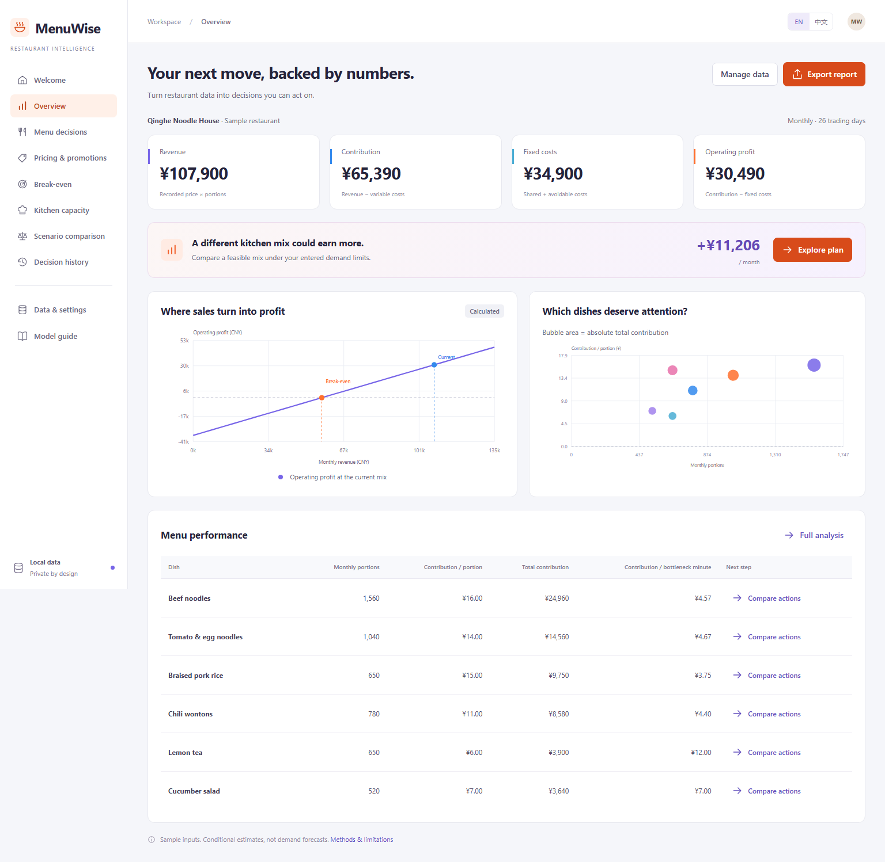
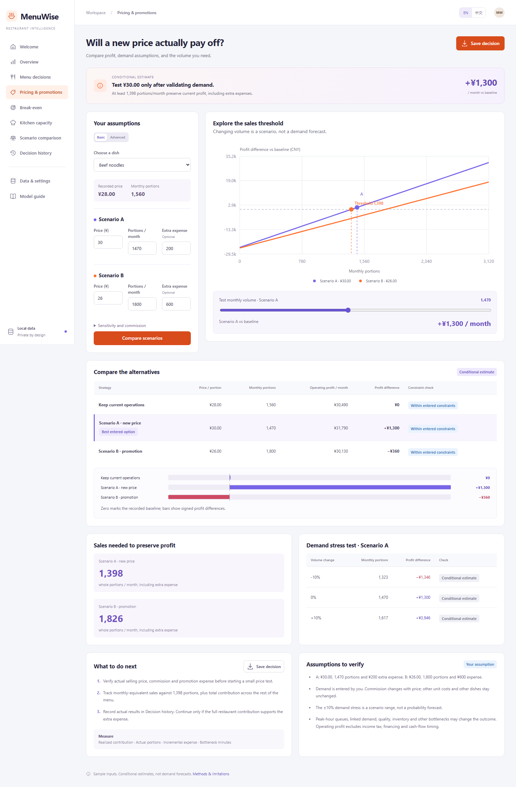
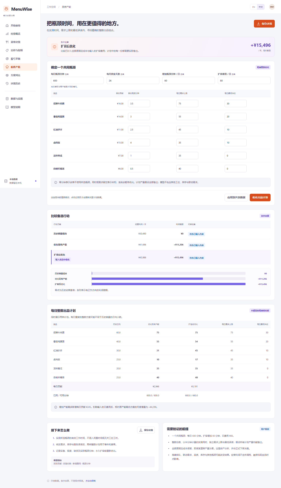
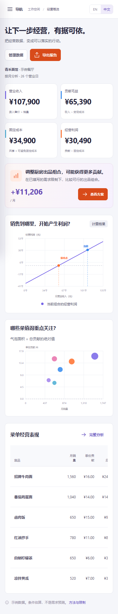

# MenuWise

A bilingual restaurant decision assistant with a separately tested economic engine, interactive analytics, saved decision reviews, and browser-local data processing.

**Open online:** [Private MenuWise app](https://menuwise-restaurant-decisions.humble-field-3507.chatgpt.site). The existing owner-only access is preserved.

Version 2.0 adds an orange/violet analytics dashboard inspired by Semrush and SparkToro, complete English / Simplified Chinese switching, four-field basic entry, mapped imports, live scenario simulations, and actual-outcome reviews.

## Open the application — no installation

1. If using the ZIP, choose **Extract All** first.
2. Double-click **MenuWise.html**. It opens in your default browser. Edge and Chrome are recommended and have been tested.
3. Choose **EN** or **中文**, then click **Explore the sample / 体验示例餐厅**.
4. **Success indicator:** the overview shows monthly revenue **¥107,900**, contribution **¥65,390**, fixed costs **¥34,900**, and operating profit **¥30,490**.

No terminal, Node.js installation, local server, API key, account, or internet connection is needed for the offline file. The complete runtime, including Excel import, is embedded in it. `dist/index.html` is the same application prepared for static hosting. A private hosted version, when available, requires the hosting account's sign-in; its calculations and user data still run locally.

## What you can do

| Screen | Business question | Working features |
|---|---|---|
| 开始使用 | Where should I start? | Sample restaurant, data entry, model explanation |
| 经营概览 | What is left after costs? | Four distinct accounting totals, profit/revenue line with break-even marker, interactive contribution/volume scatter |
| 菜单决策 | Keep, improve, promote, or remove? | Four alternatives, avoidable costs, cross-sales effects, replacement contribution and time |
| 定价与促销 | What does another price require? | Two editable price/volume assumptions, fees, required sales, sensitivity |
| 盈亏平衡 | What daily sales support my target? | Weighted sales-mix CVP, daily/monthly thresholds, cost-reduction and cost-increase comparisons, capacity checks |
| 厨房产能 | Which combinations fit the kitchen? | Exact bounded integer optimization, demand caps, minimum commitments, expansion costs |
| 方案对比 | Which saved choices are comparable? | Two to four saved snapshots, baseline mismatch notices, financial comparisons |
| 决策历史 / Decision history | Did our action work? | Saved inputs, planned/testing/reviewed status, action checklist, actual revenue/costs/profit, bilingual HTML and PDF reports |
| 数据与设置 | Are my inputs trustworthy? | Manual editing, CSV/XLSX templates, previewed imports, validation, local persistence, JSON backups |

Every module follows: **business question → inputs → analysis → alternatives → conditional recommendation → action plan**. Revenue, contribution margin and operating profit always have different labels. The app never invents customer demand, elasticity, benchmark margins, or historical trends.

## Use your own restaurant data

1. Open **Data & settings / 数据与设置**. For a fresh menu, choose **Start a new restaurant / 新建餐厅**.
2. Basic mode needs only **dish name, price, base variable cost, and monthly portions**. Enter `0` explicitly when a required numeric value is genuinely zero.
3. Enter shared fixed costs to obtain operating profit and break-even. Add trading days, bottleneck minutes and demand caps when you want to verify operations. Blank means unknown; confirmed zero is distinct.
4. Use **Advanced / 进阶模式** for commission, time, demand caps, minimum commitments, avoidable fixed costs and cost details. Choose either total base variable cost or detailed components, never both.
5. Click **Save shared data / 保存共享数据**. All decision modules use it; saved history retains its original snapshots.
6. **Success indicator:** the saved confirmation appears and your inputs remain after reloading.

### Import a spreadsheet

1. Choose **Import CSV / Excel / 导入 CSV / Excel** and select a local `.csv`, `.tsv` or `.xlsx` file (up to 5 MB, 40 dishes). Convert legacy `.xls` to `.xlsx` first.
2. Select the worksheet and header row (first ten rows supported). Recognized English/Chinese headings map automatically; map custom headings manually and ignore unused columns.
3. Choose the decimal convention, `1,234.50` or `1.234,50`. CSV comma, semicolon and tab delimiters are detected. UTF-8 is preferred; GB18030 is a fallback.
4. Map name, price and monthly sales, plus either total base variable cost or cost components. Formulas/complex cells and missing required costs are rejected: paste calculated values first. If both total and component costs are present, explicitly choose the cost source.
5. Click **Preview calculation / 预览计算**. Check the totals, omitted-field defaults and cost source, then choose **Replace menu with preview / 用预览替换菜单**.
6. **Success indicator:** imported dishes appear and the contribution total agrees with the preview. When replacing the fictional sample, sample fixed costs, trading days and capacity are cleared. Existing genuine restaurant settings are retained.

Optional expenses and minimum commitments default to zero, and the preview lists omitted fields. Missing time/demand remains unknown and blocks optimization. Confirmed zero bottleneck time is supported. Base variable cost excludes separately entered commission. Shared fixed costs exclude dish-specific avoidable costs. Fixed salaries belong in overhead; only per-portion labor belongs in variable cost. A number alone cannot prove that an expense has been classified correctly.

## Worked examples

All examples below are fictional teaching inputs shipped with the application, not industry benchmarks or forecasts.

### 1. Understand the baseline

The sample restaurant operates 26 days per month. Shared fixed costs are ¥32,000; dish-specific avoidable fixed costs total ¥2,900.

- Revenue: **¥107,900**.
- Variable costs: **¥42,510**.
- Contribution: **¥65,390**.
- Operating profit: **¥65,390 − ¥34,900 = ¥30,490**.
- Bottleneck use: **13,975 minutes/month**, or **537.5 minutes/day**.

### 2. Compare prices for 招牌牛肉面

Current price is ¥28, unit variable cost ¥12, and volume 1,560 portions/month.

| Alternative | Price | Assumed monthly sales | Extra monthly cost | Profit change |
|---|---:|---:|---:|---:|
| Keep current price | ¥28 | 1,560 | ¥0 | ¥0 |
| Price test A | ¥30 | 1,470 | ¥200 | **+¥1,300** |
| Promotion B | ¥26 | 1,800 | ¥600 | **−¥360** |

At ¥30, preserving the original profit requires **1,398 portions/month** after the extra ¥200 cost. At ¥26, it requires **1,826 portions/month** after the ¥600 promotion cost. These volumes are thresholds, not predicted demand. With a percentage commission, the engine recalculates commission from the new price before comparing margins.

### 3. Do not remove a dish just because it looks slow

卤肉饭 earns ¥15 contribution per portion at 650 portions/month: **¥9,750 total contribution**. Only ¥900/month of its fixed cost is avoidable. With no replacement or cross-sales effects, removing it changes profit by **¥900 − ¥9,750 = −¥8,850/month**. Its existing minimum-supply commitment also blocks execution of a removal plan. Shared rent is not “saved.”

### 4. Test the profit target against capacity

The current sales-mix contribution ratio is **65,390 / 107,900 = 60.6024%**.

- Monthly break-even revenue: **¥57,588.47**.
- Average daily break-even revenue: **¥2,214.94**.
- Revenue for ¥40,000/month operating profit: **¥123,592.45/month**, or **¥4,753.56/day**.
- At the unchanged mix, that target needs **615.67 bottleneck minutes/day**, above the available 600. The app flags this mismatch.

If minimum-supply commitments require more output than the algebraic target threshold, the app separately calculates the higher plan needed to satisfy those commitments. The target is treated as “at least this profit,” not an artificial ceiling.

### 5. Optimize the constrained kitchen

Under the sample demand limits and minimum commitments, an exact optimum at **600 minutes/day** is:

| Dish | Portions/day |
|---|---:|
| 招牌牛肉面 | 75 |
| 番茄鸡蛋面 | 55 |
| 红油抄手 | 31 |
| 卤肉饭 | 10 |
| 凉拌黄瓜 | 35 |
| 自制柠檬茶 | 40 |

Daily contribution is **¥2,946**, implying **¥41,696/month operating profit** if every planned portion sells on each of the 26 operating days. All original fixed costs remain charged.

At **660 minutes/day**, exact optimal daily contribution is **¥3,191**. Extra contribution is ¥245/day. If those extra minutes cost ¥80/day, net incremental profit relative to the 600-minute optimum is **(¥245 − ¥80) × 26 = ¥4,290/month**. Monthly operating profit after the expansion cost is **¥45,986**. The app shows the full comparison and the conditional nature of selling that mix.

## Save, export, and restore

1. Compare alternatives in a decision module. Valid edits recalculate the recommendation, comparison and chart. Invalid inputs clear the previous result and show a message.
2. Click **Save decision / 保存决策** and optionally name the decision.
3. In **Decision history / 决策历史**, open **Review & report / 复盘与报告**. Check completed actions, update the status and enter actual revenue, variable costs and fixed costs for a comparable month. Include trial expenses in those actual cost totals.
4. Choose **Open report / 查看报告**, then **Print / Save PDF / 打印 / 保存 PDF**. Select the browser's PDF destination. **Export HTML / 导出 HTML** creates a standalone report in the current language. Use Ctrl+P to print the exported HTML.
5. Use **Scenario comparison / 方案对比** for 2–4 saved decisions. Different baselines are flagged; their gains are not additive.
6. Export a **JSON backup / JSON 备份** regularly. Restore it after reviewing the replacement notice.
7. **Success indicator:** decisions, actions and actual results survive reload; reports retain saved inputs and switch language. User-entered restaurant names, dish names, titles and notes remain exactly as written.

The app reads valid v1 local data automatically. Legacy scenarios are explicitly marked as recalculated with model 2.0, while their original inputs are retained. Corrupt storage is preserved instead of silently overwritten. At most 50 saved decisions are supported. Each browser/URL has separate storage; there is no automatic account synchronization.

Reports contain full financial inputs. Sharing an exported file shares those inputs. Nothing is uploaded by the offline application. Browser storage is scoped to the current browser and URL/file location; moving the file or using another browser may require restoring the JSON backup. Private browsing, blocked storage, clearing browser data, or a full storage quota can prevent persistence. The app reports save failures rather than claiming success.

## Model documentation and references

See [MODELS.md](docs/MODELS.md) for formulas, algorithm, assumptions, rounding and scope. Authoritative methodological references:

- [ACCA: Cost-volume-profit analysis](https://www.accaglobal.com/uk/en/student/exam-support-resources/fundamentals-exams-study-resources/f5/technical-articles/CVP-analysis.html).
- [OpenStax, Managerial Accounting §10.4: Keep or discontinue a segment/product](https://openstax.org/books/principles-managerial-accounting/pages/10-4-evaluate-and-determine-whether-to-keep-or-discontinue-a-segment-or-product).
- [OpenStax, Managerial Accounting §10.6: Decisions with constrained resources](https://openstax.org/books/principles-managerial-accounting/pages/10-6-evaluate-and-determine-how-to-make-decisions-when-resources-are-constrained).

The application uses exact integer optimization, rather than interpreting a contribution-per-minute ranking as a guaranteed integer optimum. Qualitative tradeoffs, uncertain demand and other unmodeled constraints remain matters for the owner to evaluate.

## Engineering and validation

- `src/engine.js`: pure financial/optimization functions; no UI, storage, or network access.
- `src/import.js` and `src/data.js`: CSV parsing, flexible mappings, numeric conventions, missing-data flags, validation and safe exports.
- `src/decisions.js`: decision comparisons, snapshots and migration.
- `src/ui.js`, `src/i18n.js`, `src/charts.js`: bilingual workflows, real-calculation charts, persistence, imports and reports.
- `src/style.css`: responsive design and print styling.
- `vendor/exceljs.min.js`: vendored ExcelJS browser runtime; MIT license included.
- `build.cjs`: embeds local dependencies into `MenuWise.html` and `dist/index.html`.
- `tests/*.test.cjs`: 76 regression tests, including 300 seeded exhaustive optimizer cases.
- `tests/browser.cjs`: optional full Edge/Chrome interaction suite; requires developer Playwright and ExcelJS modules. See [QA.md](docs/QA.md).
- `docs/v2-*.png`: verified current screenshots. [QA.md](docs/QA.md) records tested workflows and verification limits.

Developer-only commands, unnecessary for using the app:

```sh
npm test
npm run build
```

Both use Node.js built-ins and require no dependency installation. Browser automation is an optional separate developer check. The shipping application itself has no CDN or backend dependency.

## Screenshots

### Business overview



### Pricing and sensitivity



### Kitchen capacity



### Mobile overview



Sample exported reports: [English PDF](docs/sample-report-en.pdf) · [中文 PDF](docs/sample-report-zh.pdf). These contain fictional inputs and review results.

## Practical limits

The engine models one shared kitchen bottleneck, 0.5-minute time units, whole portions, independent demand bounds and linear variable costs. It does not model multiple kitchen workstations, queues, batch preparation, ingredient inventory, linked demand, taxes, financing, cash flow, or price elasticity. Historical demand and forward demand assumptions are explicitly different fields. Plans assume their output sells. Fixed-cost steps and revenue outside the relevant range require revised inputs. The app refuses infeasible or oversized optimization tasks instead of labeling guesses as optimal.
